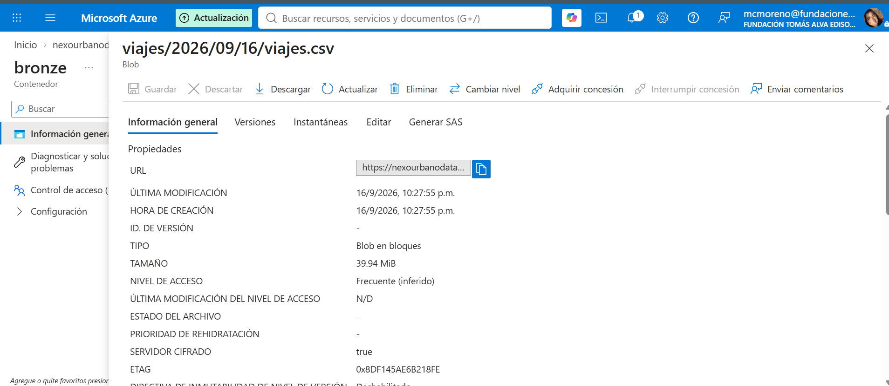

# NexoUrbano 2026 — pack del TP

Este directorio es el **pack de cátedra** del trabajo práctico evaluativo.

| Archivo | Quién lo usa |
|---|---|
| [TP_NexoUrbano_2026.md](TP_NexoUrbano_2026.md) | Estudiantes (enunciado completo) |
| [ANEXO_DOCENTE.md](ANEXO_DOCENTE.md) | Docentes (rúbrica viva, orales, plan B) |
| [tools/generar_datos.py](tools/generar_datos.py) | Squads, día 0 |
| [docker-compose.yml](docker-compose.yml) | Mongo, Cassandra, Neo4j, MySQL, MinIO |
| [contratos/bronze_viajes.yaml](contratos/bronze_viajes.yaml) | Plantilla de data contract |
| [.env.example](.env.example) | Secretos fuera de Git |

## Arranque en 10 minutos

```bash
python3 tools/generar_datos.py --seed 101 --n-viajes 250000
docker compose up -d mysql mongo minio
```

Luego cada squad copia la estructura de carpetas del enunciado a **su** repositorio (no entreguen este pack mezclado con el producto).

## Semilla

`--seed` = número de grupo × 100 + comisión. Dos grupos con la misma semilla tienen los mismos IDs: eso se considera copia.

## Hardware

- 8 GB RAM: levantar **un** NoSQL a la vez.
- 16 GB: MySQL + Mongo + Neo4j juntos; Cassandra aparte.
- Hadoop/Hive/HBase: sandbox Docker de la cátedra o el que documente el squad.

Azure y Databricks van por **cuenta free / Community**. Si piden tarjeta, MinIO + Spark local con ADR de paridad (está permitido en el enunciado).

## M2 - Azure Data Lake

**Suscripción:** Azure subscription 1
**Región:** Brazil South
**SKU:** Standard_LRS

**URI del dataset en Bronze:**

​```
abfss://bronze@nexourbanodata2026.dfs.core.windows.net/viajes/2026/09/16/viajes.csv
​```

**Evidencia del contenedor:**



## M8 - Spark batch (Bronze → Silver → Gold)

## M8 - Spark batch (Bronze → Silver → Gold)

**Script:** `05-spark/batch/job_gold.py`

**Cómo correrlo** (con Docker Desktop abierto):

docker compose up -d spark
docker compose exec -u root spark chown -R spark /opt/spark-lake
docker compose exec spark /opt/spark/bin/spark-submit --master "local[*]" --driver-memory 2g /opt/spark-apps/batch/job_gold.py

El `chown` le da permisos al usuario `spark` para escribir en el volumen `spark_lake`. Se corre una vez, y de nuevo si se borra el volumen. Silver y Gold se guardan en ese volumen de Docker y no están en el repo. Para verlos: `docker compose exec spark ls /opt/spark-lake/gold`.

**Volumen:** 250.000 viajes (seed 402). 

**Calidad de dato (Bronze → Silver):** 244.944 de 250.000 filas pasan (98%). Se rechazaron 5.045 por duración fuera del rango 30 s – 4 h y 11 por km inválido. Las reglas de ids nulos y de fin antes que inicio no rechazaron ninguna.

**Zona horaria:** `ts_start` viene en UTC y se convierte a hora de Buenos Aires antes de agrupar por fecha y hora. Por eso el primer día (28/02) tiene solo 312 viajes: los datos arrancan el 01/03 00:00 UTC, que son las 21:00 locales del día anterior.

**Silver:** Parquet particionado por `fecha`.

**Gold:**
- `gold_ops_diaria`: viajes, minutos, km, ingresos y % de clima adverso por día. Los ingresos son la suma de `fare_ars` del CSV.
- `top_estaciones_origen`: las 10 estaciones con más viajes.
- `gold_por_plan`: viajes, ingresos y duración media por plan de rider.

**Join con riders:** `data/riders.csv` (120 riders) se une por `rider_id`. Se usó el CSV directo y no la tabla de Sqoop (M7). 0 viajes quedaron sin rider. En el plan físico Spark eligió `BroadcastHashJoin`, porque la tabla es chica.

**Clima adverso:** `clima_codigo >= 51` (61, 63 y 80). Parecen códigos de lluvia, pero es una inferencia: el generador no los documenta. Resultado: 33,4% de los viajes. El código viene en el CSV de viajes.

**Explain:** ver `evidencias/spark/salida_job_gold.txt` y el análisis en `evidencias/spark/explain_notas.md`. Se observan partition pruning (`PartitionFilters` sobre `fecha`), column pruning (`ReadSchema` con una sola columna) y broadcast join.

**Observaciones sobre los datos:**
- La velocidad calculada es irreal para monopatines: el 71,8% de los viajes supera los 25 km/h, el 58,6% los 40 y el 44,4% los 60, con un máximo de 679 km/h. No se filtró por velocidad porque con un umbral de 25 km/h se descartaría más del 70% del dataset. Una hipótesis es que el generador sortea km y duración por separado, pero no se verificó.
- El generador sortea el clima, los km, la duración y el plan de forma independiente. Por eso el % de clima adverso es casi igual cada día y los planes no se diferencian entre sí.

**Pendiente:** join con el clima de Open-Meteo (M3), que depende de la tabla de otra integrante.


### M9 · Spark Streaming: Alertas Operacionales

**Caso de Uso y Reglas de Negocio**
El sistema procesa telemetría en vivo para detectar monopatines con batería baja (`battery_low`) o fallos de pago recurrentes (`payment_fail`) agrupados en ventanas móviles de 2 minutos (con un slide de 30 segundos). Esto permite alertar a operaciones sobre posibles fraudes de "viaje fantasma" o desconexiones masivas de la flota. Los resultados se emiten por consola y se persisten simultáneamente en formato Parquet (`gold_alerts`) para auditoría.

**Gestión de Latencia (Watermark) y Eventos Descartados**
Se configuró un *watermark* de 1 minuto para tolerar el retraso natural de la red móvil. Si el reloj interno del streaming avanza y fija su límite mínimo (ej. 12:01:00), cualquier monopatín que recupere la señal y envíe un evento tardío (ej. un registro a las 12:00:33) es descartado automáticamente por el sistema. Esto se validó en las pruebas para asegurar que no se recalculen ventanas ya cerradas.

**Hechos Mínimos Verificables (HMV)**
 **Demostración:** El video de 30 segundos mostrando la reacción en vivo de la consola y la creación de las ventanas se encuentra en: `evidencias/spark/evidencia_m9_alertas.mp4`
**Código:** El script de ejecución está en `job_alerts.py`

### M10 · MongoDB: Catálogo Comercial (Documentos y CRUD)

**Comparativa SQL vs. Modelo Documental (MongoDB):**
En una base de datos relacional, modelar este catálogo requeriría al menos 3 tablas (`Productos`, `Precios_Ciudad` y `Producto_Tags`) unidas por 3 costosos `JOINs` para averiguar el precio de un casco "premium" en Mendoza. En MongoDB, al usar un modelo de documentos anidados, toda la información de stock, tags y precios vive dentro del mismo objeto JSON. Esto elimina la necesidad de uniones relacionales, logrando lecturas instantáneas mediante índices compuestos (`categoria` + `detalles.tags`), lo que simplifica drásticamente el código del sistema y acelera la respuesta para el e-commerce de la flota.

**Hechos Mínimos Verificables (HMV)**
**Script CRUD:** El código de creación, actualización y borrado está en `06-mongodb/crud.js`.
**Métricas de Índice:** Al medir con `explain("executionStats")`, la búsqueda sin índice examinó los 300 documentos del catálogo. Tras crear el índice compuesto, la misma consulta fue directa y examinó solo 65 documentos, confirmando la optimización estructural.

### M11 · MongoDB: Agregaciones (Analítica Comercial)

**Pipeline de Analítica**
Se desarrolló un pipeline de agregación robusto para generar reportes comerciales automatizados. El flujo procesa datos transaccionales incluyendo:
- `$match`: Filtrado de ventas correspondientes al último trimestre.
- `$lookup`: Cruce con la colección `productos` para integrar nombres y categorías.
- `$facet`: Procesamiento multifase en paralelo para obtener el total facturado por categoría, las ventas agrupadas por mes cronológico, y el Top 5 de productos por volumen de ingresos.
- `$project`: Formateo y limpieza del documento final.

**Hechos Mínimos Verificables (HMV)**
**Script Pipeline:** El código con el generador de datos y la agregación se encuentra en `06-mongodb/pipeline.js`.
**Reporte Exportado:** El resultado analítico final está guardado en `09-producto/ventas_agg.json`.
**Bonus Geoespacial:** La estructura de ventas generada incluye el nodo `ubicacion_tienda` con formato oficial `GeoJSON` (Point) y coordenadas geolocalizadas, preparando la colección para índices `2dsphere`(búsquedas por mapa/radio).

## M12 - Cassandra (series temporales de sensores)

**Archivos:** `07-cassandra/schema.cql` (keyspace y tabla), `carga.cql` (carga del CSV) y `queries.cql` (consultas). La evidencia está en `evidencias/cassandra/`.

**Modelo:** keyspace `nexo` con RF=1, porque el sandbox tiene un solo nodo (en producción se usaría RF ≥ 3). La tabla `lecturas_vehiculo` tiene `vehicle_id` como partition key y `ts` como clustering en orden descendente, porque todas las consultas empiezan por un vehículo y piden primero lo más nuevo.

**Datos:** `data/lecturas_sensores.csv`, con 6.000 lecturas de 80 vehículos (el enunciado pide al menos 5.000).

### Cómo cargarlo

Con Docker Desktop abierto.

**Paso 1.** Levantar Cassandra y esperar a que esté lista. Tarda uno o dos minutos, y tiene que aparecer una línea que empiece con `UN`:

docker compose up -d cassandra
docker exec nexo-cassandra nodetool status

**Paso 2.** Crear keyspace y tabla:

cat 07-cassandra/schema.cql | docker exec -i nexo-cassandra cqlsh

**Paso 3.** Copiar el CSV dentro del contenedor, porque Cassandra no ve la carpeta `data`:

# Git Bash
MSYS_NO_PATHCONV=1 docker cp data/lecturas_sensores.csv nexo-cassandra:/tmp/lecturas_sensores.csv

# PowerShell
docker cp data\lecturas_sensores.csv nexo-cassandra:/tmp/lecturas_sensores.csv

**Paso 4.** Cargar. Si la tabla ya tenía datos de una carga anterior, vaciarla antes con `docker exec nexo-cassandra cqlsh -e "TRUNCATE nexo.lecturas_vehiculo"`:

cat 07-cassandra/carga.cql | docker exec -i nexo-cassandra cqlsh

**Paso 5.** Verificar. Tiene que dar 6000 en total y 88 para V0073, que son las filas que tiene el CSV:

docker exec nexo-cassandra cqlsh -e "SELECT COUNT(*) FROM nexo.lecturas_vehiculo"
docker exec nexo-cassandra cqlsh -e "SELECT COUNT(*) FROM nexo.lecturas_vehiculo WHERE vehicle_id = 'V0073'"

### Si el conteo da 80

El CSV trae las fechas como `2026-05-01T00:00:05+00:00`. Sin el formato correcto, `COPY` no las interpreta bien: todas las lecturas de un vehículo quedan con la misma hora y Cassandra las pisa sin avisar, aunque el `COPY` diga `6000 rows imported`. Por eso `carga.cql` incluye `DATETIMEFORMAT`. Si te pasa, actualizá el repo con `git pull`, vaciá la tabla con `TRUNCATE` y recargá.

### Consultas y evidencia

cat 07-cassandra/queries.cql | docker exec -i nexo-cassandra cqlsh

- **Consulta 1:** las últimas 20 lecturas de un vehículo.
- **Consulta 2:** un rango horario de un vehículo.
- **Consulta 3:** no filtra por `vehicle_id`, y Cassandra la rechaza con un `InvalidRequest` que menciona `ALLOW FILTERING`. Tendría que recorrer todas las particiones, y ese es el punto del módulo.

**Archivos de evidencia** (`evidencias/cassandra/`):
- `salida_queries.txt`: la salida de las tres consultas, con el error de la tercera.
- `conteo.txt` y `describe_tabla.txt`: el conteo de filas y la estructura de la tabla.
- `cassandra_ultima_lectura.txt`: la última lectura de cada vehículo. Sale de `PER PARTITION LIMIT 1`, que devuelve la primera fila de cada partición. Como el clustering es `ts DESC`, esa primera fila es la más nueva.

Las decisiones de consistencia (ONE vs QUORUM) están en `ADR/007-cassandra.md`.

### M13 · Neo4j: Grafo Social y Recomendaciones

**Modelo de Datos y Generación**
Se diseñó e implementó un modelo de grafos para representar la red social de la plataforma NexoUrbano. Mediante un script Cypher automatizado, se generaron 85 nodos de usuarios (`Rider`), además de entidades físicas (`Estacion`) y lógicas (`Interes`). Las conexiones se crearon de forma probabilística incluyendo relaciones del tipo `AMIGO_DE`, `VIAJO_CON`, `SALE_DE` y `LE_GUSTA`.

**Consultas Analíticas y Prevención de Fraude**
Se desarrollaron queries orientadas a la recomendación y seguridad:
- Búsqueda de amigos en común para sugerir nuevas amistades.
- Algoritmo de "Camino más corto" (Shortest Path) entre usuarios de la red.
- Motor de recomendación de viajes compartidos (riders que inician viajes en la misma estación pero no son amigos).
- **Bonus (Patrón de Fraude):** Detección de comportamientos anómalos, rastreando a 3 riders retirando vehículos en la misma estación con menos de 2 minutos de diferencia.

**Hechos Mínimos Verificables (HMV)**
**Script de Creación:** El código generador del grafo se encuentra en `08-neo4j/grafo.cypher`.
**Resultados Cypher:** Las salidas en formato texto de las 4 consultas analíticas requeridas están documentadas en `08-neo4j/resultados_queries.md`.
**Capturas del Grafo:** La representación visual de la red completa y el mapa del camino más corto se encuentran en la carpeta `evidencias/neo4j/`.